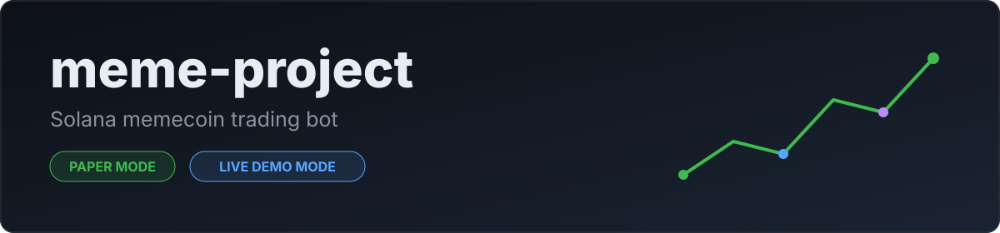
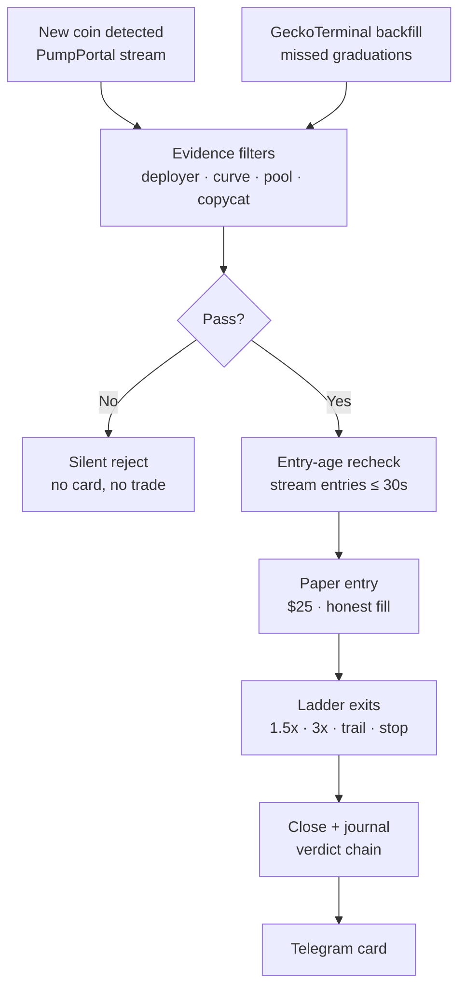
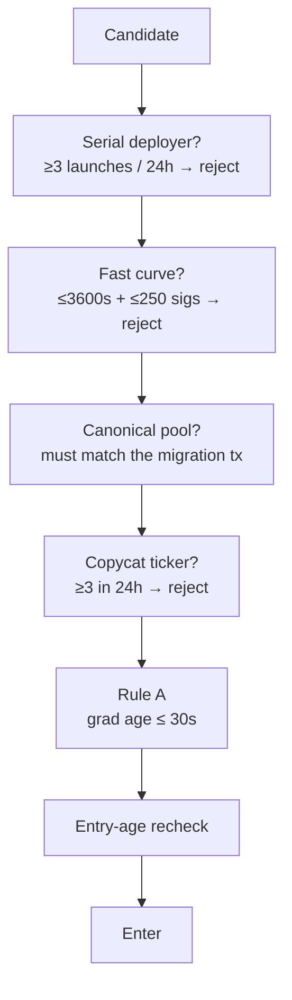
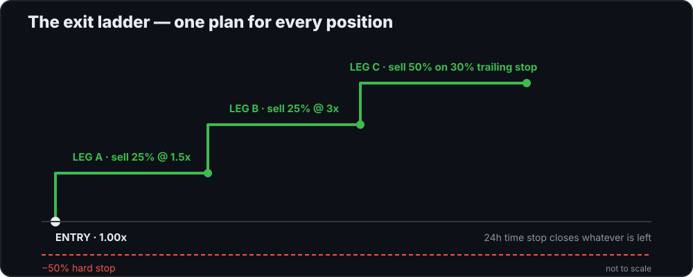
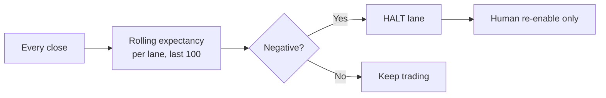
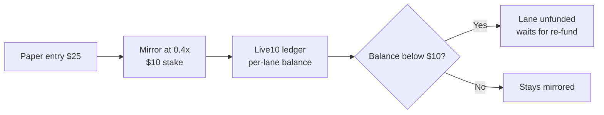
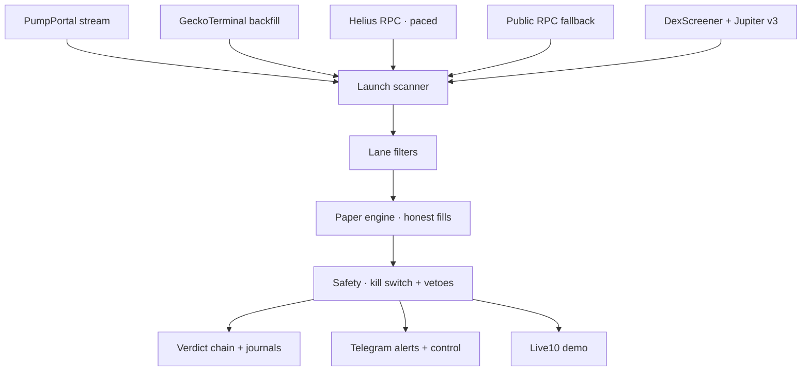
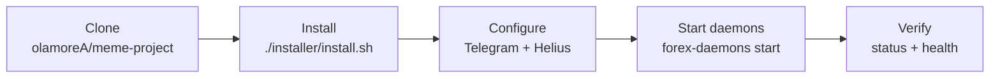
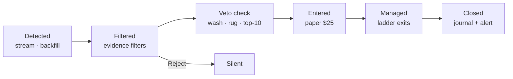

# meme-project — Solana memecoin trading bot (paper + live demo)

Solana memecoin trading bot with two modes: paper mode and a live demo mode. It hunts pump.fun graduations and already-running memecoins, trades them with honest fills, and journals every decision. The live demo runs the same system on live market data — very close to live trading, with no real money at stake.

> ⚠️ **Two modes, no real money.** Paper mode ($25 paper stakes) and the Live10 live demo ($10 demo account, same entries and exits on live market data) — the demo is very close to live trading, but no real money moves in either mode. Live trading is gated behind four gates (sustained positive paper expectancy, a proven entry strategy, Top Picks winning more than losing on paper, hardened live safety) and an explicit go-ahead from the owner. Not financial advice.

---

## How it works

Every coin flows through the same pipeline — detect, filter, enter, manage,
close, journal. Most candidates are rejected silently; only the few that pass
every check get paper money.



Detection does not depend on one source: the live stream catches
graduations as they happen, and the backfill sweeps up anything the stream
missed. Curve reads go through Helius (paced) with a keyless public-RPC
fallback, so entries keep flowing while Helius throttles.

---

## Modes

| Mode | What it is | Stakes |
|---|---|---|
| Paper mode | Full paper trading across all five lanes | $25 a coin (momentum $1) |
| Live demo mode (Live10) | The same entries and exits mirrored onto a $10 demo account, on live market data | $10 a coin (0.4x scale) |

The live demo is the closest thing to live trading short of real funds:
same detection, same filters, same fills, same fees — the only difference
is the account is a demo balance.

---

## The lanes

Five lanes trade five different edges. All five run in paper; the demo
account mirrors four of them.

| Lane | Edge | Paper stake | Exits |
|---|---|---|---|
| `grad_select` | Best graduations only — four evidence filters + 30s entry rule | $25 | Ladder |
| `grad_raw` | Raw graduations through the same filters | $25 | Ladder |
| `tranche` | Graduations held through the ladder | $25 | Ladder |
| `tranche_protect` | Graduations with protected exits | $25 | Ladder |
| `momentum` | Coins that are already running | $1 | Ladder |

### grad_select — the flagship filter chain



Every filter fails closed on unknown data: if the evidence cannot be
checked, the coin is rejected, not guessed at.

---

## The exit ladder



Every position follows the same plan — no discretion, no hope-trading:

| Leg | Action | Trigger |
|---|---|---|
| A | Sell 25% | 1.5x |
| B | Sell 25% | 3x |
| C | Sell 50% | 30% trailing stop from the peak |
| Stop | Sell all | −50% |
| Time | Sell all | 24h after entry |

A breakeven stop arms once leg A banks, and one dip buyback is allowed per
position (after a leg banks, on a ≥30% retrace, price at or above entry,
age under 24h).

---

## A real trade, step by step

### Winner — EXEN, 20 Nov 2026

| Step | What happened |
|---|---|
| Entry | `tranche_protect` entered EXEN |
| Leg A | Banked at 2x — first quarter sold |
| Run | The coin kept running to **36.9x** |
| Close | 24h time stop, 13:40 WAT |
| Result | **+$897.39 paper** · **+$358.96 demo** |

### Loser — grad_select, 20 Nov 2026

| Step | What happened |
|---|---|
| Entry | `grad_select` entered at 20:57 WAT, 0.5s after graduation, via the live stream |
| Close | 21:02 WAT at 0.48x — the −50% hard stop |
| Result | **−$12.93 paper** |

The loser matters as much as the winner: the stop fired in five minutes,
the loss was capped at half a stake, and the journal recorded it like any
other close. No single coin is predictable — the edge is statistical,
across many trades.

---

## Safety

### Kill switch



### Veto engine

| Veto | Rule |
|---|---|
| Wash-trade pattern | Hard veto |
| Repeat-rug deployer | Hard veto |
| Top-10 concentration | Hard veto |
| Bundle / insider cluster | Veto only at ≥50% share, or 20–50% with sampled wallets net-selling |

No score overrides a veto. Smart-money agreement adds zero score anywhere.

### Honest fills

Every fill is adverse to the quoted price. Slippage scales with pool
liquidity (0.5% floor), and the 1.25% pump.fun curve fee is charged on
every trade. Paper numbers are therefore pessimistic by design — if a lane
wins on paper, it wins despite the costs, not because of them.

---

## Live10 — the live demo mode



The Live10 demo is the project's live demo mode: the same lanes, the same entries and exits, mirrored onto a $10 demo account at 0.4x scale, on live market data. It is very close to live trading — the only difference is the account is a demo balance, not real funds. It must not lose its balance, and it must make a profit — two constraints that only a real edge satisfies.

---

## Architecture



## Install



```bash
git clone https://github.com/olamoreA/meme-project
cd meme-project
./installer/install.sh --agent --non-interactive --prefix ~/.forex-agent
./scripts/forex-daemons start
./scripts/forex-daemons status
```

Paper mode is the default — no broker account, no private keys. Market data
comes from Helius (free tier) with a keyless public-RPC fallback, plus
DexScreener and GeckoTerminal quotes.

## Signal flow



## Repository layout

```
.
├── agent/            # Agent interfaces: MCP server, event bus, notifications, tools
├── backtesting/      # Offline strategy backtesting engine
├── broker/           # Execution layer, incl. the mainnet executor (built, not deployed)
├── config/           # Configuration loading + defaults
├── core/             # Signals, strategies, indicators, risk, execution, reconciliation
├── daemon/           # Background monitors + launch scanner (the trading lanes) + supervisor
├── docs/             # Deep-dive docs (architecture, install, security, operations…)
├── installer/        # Idempotent Linux installer
├── intelligence/     # Correlation, economic calendar, experience learning
├── ops/              # Operations helpers
├── scripts/          # CLI, daemon control, local API
├── storage/          # Journal + state persistence
├── tests/            # Test suite
└── worker/           # Cloudflare Worker: control-plane API, D1 schema
```

Start with the docs: [ARCHITECTURE](docs/ARCHITECTURE.md) · [INSTALL](docs/INSTALL.md) · [CONFIGURATION](docs/CONFIGURATION.md) · [OPERATIONS](docs/OPERATIONS.md) · [SECURITY](docs/SECURITY.md) · [TELEGRAM_SETUP](docs/TELEGRAM_SETUP.md)

## Requirements

- **Linux**, **Python 3.12+**
- **Node 18+** — only for the Worker contract tests.

## Using it

```bash
./scripts/forex status
./scripts/forex health
./scripts/forex broker-status
./scripts/forex signals --json
./scripts/forex positions
```

## 🔔 Telegram alerts

Trade opens/closes and lane alerts go to Telegram, with a control bot for
status, halts, and per-coin lookups. Setup: [docs/TELEGRAM_SETUP.md](docs/TELEGRAM_SETUP.md).

## Tests

Most suites are plain scripts run directly with Python 3.12:

```bash
python3 tests/test_<name>.py
```

## Safety model

- **Two modes, both safe.** Paper mode and the live demo move no real money — the demo runs on live market data with a demo balance.
- **Live fails closed.** The live executor is built but not deployed; no
  mainnet key exists and no real trade can run through it.
- **Keyless by design.** No private keys are requested, received, stored,
  or handled anywhere.
- **Kill switch.** A lane halts on negative rolling expectancy; only a
  human can re-enable it.
- **Full journaling.** Every signal, decision, fill, and close is
  timestamped and persisted — nothing trades silently.

Read [docs/SECURITY.md](docs/SECURITY.md) before going further.

## Name

The repo grew out of a forex-agent scaffold — hence the `Forex-agent`
directory and `~/.forex-agent` paths. The trading system itself is Solana
memecoins, not forex.

## License

No license file is committed yet — add a `LICENSE` to set the terms (e.g. MIT, Apache-2.0). Demo/research software; not financial advice.
